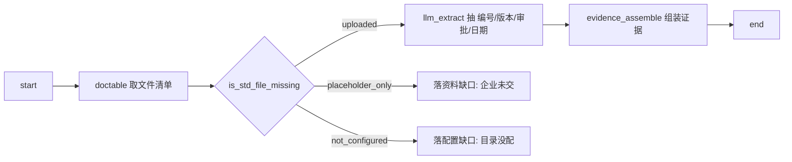
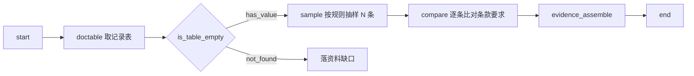

# 31 审核检查表 · 证据收集流程化与完备性判定设计

> 状态：**待裁决**（2026-10-19）｜上游：[28-设计与落地方案](28-审核检查表设计与落地方案（待审批）-V1.md) · [29-独立评审](29-审核检查表方案独立评审-V1.md) · [30-新业务可行性与产品化评估](30-审核检查表新业务可行性与产品化评估-V1.md)
> 本文回答三个问题：**① 收集证据能否流程化控制 ② 证据全与不全能否规则化判定 ③ 条款能否复用 NC 检查项**
> 依据：ISO 19011:2018 / GB/T 19011-2021 术语与条款（§二 已联网核实原文表述）· 样本实测 76 行 · 现有代码资产实测
> ★ **证据的内部结构（章节 / 明细 / 组合）已下沉到 [32-证据链分块模型设计](32-审核检查表-证据链分块模型设计-V1.md)** —— 本文 §6.3 `cert_check_evidence` 在 32 号被扩成「evidence → block → items」三层，并补 `BlockMode`/`BlockThreshold` 两列。**分块相关一律以 32 号为准。**
> ⚠️ **两处已被 [35-数据源模型与工作流实现](35-审核检查表-数据源模型与工作流实现-V1.md) 修正**：
> ① §3.2 的 `EvidenceMethod` **单值不成立** ⇒ 实测 75% 的行多源、平均 2.20 类来源 ⇒ 改 **`EvidenceMethods` 多值 JSON 数组**；
> ② 本文只覆盖 `enterprise` 来源，**漏了 `auditor` 现场/访谈**（实测 **59% 的行含**）⇒ 新增 `EvidenceOrigins` 多值 + 现场证据录入通道。**数据源一律以 35 号为准。**
> ⚠️ **第三处已被 [36-现场证据通道与规范化时序](36-审核检查表-现场证据通道与规范化时序-V1.md) 修正 —— §五「区域展开」的说法作废**：
> ③ **不是「× 区域」，是「× 部门 × 过程」**。样本里「过程/区域」那一列混了角色（`GM/MR`）、过程组（`采购过程、销售过程`）、部门组（一块含 4 个部门），**它不是区域**；且区域只有 **4** 个值而场次有 **6** 个 ⇒ 切分维度是 **场次 = 部门 × 过程**。
> ④ **数字口径同时修正**：本文 §5.2 的「64 检查项 = 59 唯一条款 + 5 条续行提问、×1.19」是**按条款号去重**的旧口径；36 号按同一份 76 行重新点数得到 **59 个唯一条款 / 17 行重复（22%）**，差额即那 5 条续行。**实施以 36 号为准：配置层 = 59 个检查项**（一个检查项可挂多条提问行），执行层 76 行，放大 **1.29×**。
> ⑤ **`RegionSensitivity` 列改名为 `DeptSensitivity`**（语义从「区域差异」改为「部门差异」），并新增 `ProcessAreaName` 存「过程/区域」原文。**检查项相关一律以 36 号为准。**

---

## 一、结论速览

| # | 你的判断 | 结论 | 关键依据 |
|---|---|---|---|
| **a** | 「收集证据是用户手动执行非常复杂的环节，能否流程化控制」 | ✅ **能，而且标准本身就是这么分的** | ISO 19011 把「收集和验证信息」（§6.4.7）与「形成审核发现」（§6.4.7 之后）列为**两个独立环节**。现有 7 类节点 + 15 个 Skill 已能配出取证 DAG；缺的不是引擎，是**4 套取证模板**（§三） |
| **b** | 「证据全与不全的判断依据能否设计规则，这是证据是否完善的关键」 | ✅ **能，但必须拆三层** —— L1 文件层 / L2 字段层 **已有现成机制**；L3 证据层**需新增「要素清单」**（§四） | `is_std_file_missing`（四态）· `is_field_empty`（三态）· `GapDetector`（`R\H` 差集）三个机制**已经在跑**，只是没人把它们串起来当"完备性判据"用 |
| **c** | 「条款可以复用 NC 检查项」 | ✅ **对，但要分清两层**：**配置层 1:1 复用**（检查项 ↔ NC 条款同一套 `ClauseCode`）；**执行层要乘部门 × 过程**（59 → 76 行） | 样本实测：76 明细行去重后 **59 个唯一条款**，**17 行（22%）是同条款跨部门重复问**（`E6.1.2` 环境因素问了 4 次）⇒ **检查项最小单位 = 条款 × 部门**，放大 **1.29×**（§五；⚠️ 旧说法「×1.19 区域」已作废，见 36 号 §3.4） |

**一句话**：你的三块判断**全部成立**，而且第 ② 块比你想的更省力——"证据全不全"的判断机器**已经会了一半**，缺的是把它**显式化成规则**并**分层归因**（是没交文件、还是文件里没这项、还是抽出来的东西不算证据）。

---

## 二、标准依据（联网核实，不是我的推断）

### 2.1 术语链：证据 ≠ 发现，标准自己就分了两步

| 条款 | 术语 | 原文要义 |
|---|---|---|
| **3.7** | 审核准则 Audit Criteria | 「用于与客观证据进行**比较**的一组要求」—— 由强制性要求 / 约定要求 / 组织自定要求构成 |
| **3.9** | 审核证据 Audit Evidence | 「与审核准则**相关**且**可验证**的记录、事实或其他信息的陈述」 |
| **3.10** | 审核发现 Audit Findings | 「将收集的审核证据与审核准则进行**比较评价**的结果」 |

**这直接支撑你第 10 轮的判断**（"一个 NC 分 2 块：一块收集证据，一块检查符合不符合"）：标准把"取证"（3.9）和"评价"（3.10）定义成**两个不同的东西**，不是我们为了做系统硬拆的。

过程链：**收集和验证信息 → 形成审核发现 → 得出结论**。你说的"收集证据这一环"，就是链条上**第一段**。

### 2.2 条款结构：取证是独立的一节

GB/T 19011-2021（等同 ISO 19011:2018）§6.4 现场审核活动下：

| 条款 | 标题 | 对本方案的意义 |
|---|---|---|
| **§6.4.5** | 审核信息的**可获取性和访问** | ⇒ 企业文档没上传 = **取证前提不成立**，必须显式区分"企业没给"与"给了但没内容" |
| **§6.4.6** | 实施审核时的**成文信息评审** | ⇒ 文件类证据的评审有独立方法（不是现场观察的替代） |
| **§6.4.7** | **收集和验证信息** | ⇒ **取证是一个独立环节，有独立方法（抽样）、独立产物（证据）、独立验收（充分/适宜）** |

> ★ **这是"能否流程化"的最强依据**：标准既然把取证单列一节、并规定了方法（抽样）和验收（充分性/适宜性），说明它**本身就是一个可定义的流程**，不是"审核员凭经验发挥"。凡是有方法、有产物、有验收标准的环节，都能流程化。

### 2.3 证据三特征 → 天然就是三条规则

ISO 19011 §3.9 定义里隐含（并在 §6.4.7 展开）审核证据必须同时满足：

| 特征 | 含义 | 能不能规则化 |
|---|---|---|
| **可验证性** | 可通过观察、测量、复核等方式**重新确认** | ✅ **纯规则**：有无出处、出处能否反查到原文 |
| **相关性** | 与审核准则存在**逻辑关联** | ⚠️ **半规则**：条款映射可配，语义相关性需 LLM |
| **充分性** | 在**数量和质量**上足以支持判断 | ✅ **可规则化**：要素清单 + 抽样量（见 §4.3） |

> 三特征不是理论，是**三个可写进配置的判据**。这是 §四 的全部基础。

### 2.4 ★ 一条关键引文（支撑"规则化"这件事本身）

查 ISO 45001 内审检查表辅导资料时看到一句行业共识，值得直接引用：

> 「如果两位审核员使用**同一份检查表**审核**同一区域**，却对是否存在不符合得出**相反结论**，说明检查表中的提问或观察项**缺乏明确的判定准则**。辅导内审检查表的最终目的，是使检查表中的**每一项都包含可观察、可记录、可复核的客观证据要求**，从而让内审结果具备**一致的判断基础**。」

**这段话就是我们做"证据完备性规则"的业务合法性来源**：审核行业本身就在追求"同一份表 → 同一结论"，而这**只能靠把判据显式写出来**。系统做规则化，不是"机器替代人"，而是**把这个行业本来就该有的判据沉淀下来**。

### 2.5 多标准：结合审核 vs 一体化审核（术语要分清）

| 术语 | 定义 | 与你的方案对应 |
|---|---|---|
| **结合审核 Combined Audit**（ISO 19011 术语） | 对**同一组织**的**多个管理体系**同时进行审核 | 你第 10 轮说的"3 个标准独立跑、得 3 个结论" = **结合审核** |
| **一体化审核 Integrated Audit** | 高度整合：**共享一个审核计划、一个审核组、一个审核报告** | 你第 10 轮说的"自动组合到一起，让用户判断是否合并" = **一体化审核** |

**关键数据**：一体化审核的**审核时间起始值 = 各标准单独审核时间总和，最大可减少 20%**。

> ⇒ 这给"合并取证"的价值**定了量**：合并的收益上限是 **20% 的审核工时**（不是 60%）。所以：
> - **合并取证值得做**（省 20%），但**不值得为它牺牲独立性**；
> - 你的设计（**让用户判断是否合并**，不合并就独立跑 3 份）**恰好落在标准允许的范围内**——标准本身就把两者当不同模式，不是二选一的对错问题。

### 2.6 文件"五性" → 完整性规则的直接依据

文件管理通行的五性：**完整性 / 准确性 / 规范性 / 可追溯性 / 有效性**。其中"完整性"被明确拆成三层面：

1. **单个文件要素齐全**（如首尾页标识、编号、版本、审批）
2. **文件体系无缺口**（从设计到售后全流程覆盖）
3. **配套记录完整**

> ⇒ 这三层**正好对应 §四 的 L1 / L2 / L3**。不是我拍的，是行业既有口径。

---

## 三、问题 a：收集证据能否流程化控制

### 3.1 为什么现在"手动执行非常复杂"—— 不是步骤多，是**每步都在判断**

拆解样本里一条真实证据的生成过程（以 4.2.4 文件控制为例）：

| 步 | 人的动作 | 复杂度来源 |
|---|---|---|
| 1 | 想"这条要什么证据" | **判断**：条款要求 → 该找哪类文件 |
| 2 | 翻企业资料，找《文件控制程序》 | **检索**：在几十份文件里定位 |
| 3 | 打开，翻到"文件编号/版本/审批"那页 | **定位** |
| 4 | 抄下来，写成"见《XX》，编号 YYY，版本 A/0，审批 ZZZ" | **抄写**（纯机械） |
| 5 | 判断"这样够不够" | **判断**：证据是否充分 |
| 6 | 判断"符不符合" | **判断**：证据 vs 准则 |

**6 步里 3 步是判断、2 步是检索定位、1 步是抄写。** 所以"复杂"的真正来源是**判断**，不是步骤。

### 3.2 流程化的关键：**把"判断"从"步骤"里剥离出来**

```
❌ 错误做法：把 6 步原样搬进系统 ⇒ 系统只是"电子的纸"，人还是要判断 3 次
✅ 正确做法：步骤流程化（1-4 步固定成 DAG）+ 判断规则化（5-6 步变成可配置判据）
```

**这正是 ISO 19011 的思路**：§6.4.7 规定"方法"（怎么取），§3.10 规定"评价"（怎么判）——**方法和评价分离**，方法可标准化，评价才需要人的专业判断。

### 3.3 ★ 四套取证模板（覆盖样本 76 行中的 62 行）

按 §2.5 的分类，取证方法只有 4 种。每种对应一个 DAG 模板：

#### T1 · 文件查阅型（样本 26 行 / 7,029 字）



**特点**：**不需要 LLM 判"符不符合"**，只需要抽取 + 要素完整性检查。这是**准确率最高、成本最低**的一类（§30 估 ~95%）。

#### T2 · 记录抽查型（12 行 / 15,960 字）



**关键缺口**：`sample` 抽样节点**现在没有**。ISO 19011 §6.4.7 明确要求抽样，所以这是**必须补**的一个原子能力（不是可选）。抽样规则要可配：抽几条、按什么维度抽（时间/部门/批号）、是否随机。

#### T3 · 现场观察型（19 行 / 17,633 字）


**AI 只能做第 1 步（提纲）**。证据必须人工产出——**这不是技术限制，是审核方法本身的要求**（现场观察必须审核员本人到场）。系统能做的是：**把提纲生成好、把照片和记录挂到条款上、把格式统一**。

#### T4 · 访谈型（5 行 / 2,306 字）


同上。**访谈答复必须人工记录**（§30 估 0-20% 自动化）。

### 3.4 现有积木够不够

| 需要的能力 | 现有资产 | 状态 |
|---|---|---|
| 流程编排 | `NodeExecutor` DAG：`start` / `end` / `docfield` / `doctable` / `skill` / `branch` / `ai_node`（7 类） | ✅ |
| 取企业文档字段/表格 | `docfield` / `doctable`（`NodeExecutor.cs:124-125`，走 `ExtractionDataResolver` 唯一口径） | ✅ |
| 判"文件在不在" | `is_std_file_missing`（**四态**：`uploaded` / `not_required` / `placeholder_only` / `not_configured`） | ✅ |
| 判"字段有没有值" | `is_field_empty` / `is_table_empty`（**三态**：`has_value` / `is_empty` / `not_found`） | ✅ |
| 结构化抽取 | `llm_extract`（`LlmExtractSkill`） | ✅ |
| 比对 | `compare`（`CompareSkill`） | ✅ |
| 组装文本 | `assemble`（`AssembleSkill`） | ✅ |
| 落缺口清单 | `GapDetector`（`R\H` 差集，字段级粒度） | ✅ |
| **抽样** | — | ❌ **缺**（T2 必需） |
| **要素完整性校验** | — | ❌ **缺**（§4.3 新增） |
| 证据持久化 | — | ❌ **缺表**（§6.3） |

**⇒ 7 类节点 + 15 Skill 里，取证链路只缺 3 样：抽样节点、要素校验、证据表。** 不是"从零造一套流程引擎"。

### 3.5 一个可直接落地的 DAG 骨架（4.2.4 文件控制）

```json
{
  "nodes": [
    { "nodeId": "n1", "nodeType": "start" },
    { "nodeId": "n2", "nodeType": "doctable",
      "config": { "tableCode": "iso9001.doc_list", "scope": "enterprise" } },
    { "nodeId": "n3", "nodeType": "skill", "skillCode": "is_std_file_missing",
      "config": { "standardFileCode": "SF-9001-7-5" } },
    { "nodeId": "n4", "nodeType": "branch", "config": { "condition": "n3.result" } },
    { "nodeId": "n5", "nodeType": "ai_node",
      "config": { "prompt": "从文件清单中抽取《文件控制程序》的 编号/版本/编制人/审批人/生效日期",
                  "outputSchema": { "docNo": "string", "version": "string",
                                    "author": "string", "approver": "string", "effectiveDate": "date" } } },
    { "nodeId": "n6", "nodeType": "skill", "skillCode": "evidence_sufficiency",
      "config": { "elements": ["docNo","version","author","approver","effectiveDate"],
                  "threshold": 0.8 } },
    { "nodeId": "n7", "nodeType": "end" }
  ]
}
```

> ★ 注意 `n6` 的 `elements` —— 这就是 §4.3 的"要素清单"，**配在 DAG 里，不是写死在代码里**。同一条 DAG 改 `elements` 就能适配不同条款，这是"规则化"的落点。

---

## 四、问题 b：证据完备性的判据 ★★ 本文核心

### 4.1 三层判据模型（L1/L2 已有，L3 需新增）

| 层 | 判的问题 | 现有机制 | 结论类型 |
|---|---|---|---|
| **L1 文件层** | 标准要求的**文件**有没有交 | `is_std_file_missing` 四态 | `uploaded` / `placeholder_only` / `not_configured` / `not_required` |
| **L2 字段层** | 文件里的**信息**抽出来没有 | `is_field_empty` 三态 + `GapDetector` `R\H` | `has_value` / `is_empty` / `not_found` |
| **L3 证据层** ⭐ | 抽出来的东西**算不算证据** | **无（本次新增）** | `complete` / `partial` / `insufficient` / `unverifiable` |

**★ 为什么必须分三层**：因为三层缺的东西**处置人不一样**，混在一起就没法派活。

| 层判定 | 谁的问题 | 怎么处置 |
|---|---|---|
| L1 `placeholder_only` | **企业**（没交） | 进"资料缺口清单"，通知企业补 |
| L1 `not_configured` | **规则作者**（目录没配） | 进"配置缺口"，进后台待办，⛔ 不算企业问题 |
| L2 `not_found` | 可能是企业没交（L1 会先拦），也可能是**提取规则没配** | 归因到具体一侧 |
| L2 `is_empty` | **企业**（交了但是空的/填了"无"） | 资料缺口 |
| L3 `insufficient` | **企业**（内容不够）或**规则**（要素配多了） | 需人看，落"待补" |
| L3 `unverifiable` | **系统**（出处丢了） | ⛔ **不许输出**，属于系统缺陷 |

> 这正是 12 号 §1.1「人工填写不可信 → 必须复核兜底」的延伸：**机器产出的东西也要能被归因**，否则专家拿到一堆"缺证据"不知道找谁。

### 4.2 L3 的三个子判据（严格对应 §2.3 三特征）

| 子判据 | 对应特征 | 判定方式 | 可规则化程度 |
|---|---|---|---|
| **出处完整性** | 可验证性 | **纯规则**：4 要素非空 + 能反查到 `cert_extraction_result` 的 `SourceFileCode` | 100% |
| **条款相关性** | 相关性 | 半规则：条款映射可配（`ClauseCode` 外键）+ LLM 语义校验 | 70% |
| **要素充分性** | 充分性 | **纯规则**：要素清单命中率 ≥ 阈值 | 90% |

#### 出处四要素（可验证性的硬门槛）

| 要素 | 要求 | 为什么要 |
|---|---|---|
| **文件名** | 必须能指到企业上传的哪一份 | 复核时人要能打开同一份 |
| **位置** | 页码 / 段落序号 / 表格行号 | 50 页文件里不给出处 = 无法复核 |
| **原文片段** | 至少一句原文（不是 AI 转述） | 防止 AI 润色成"看起来对"的话 |
| **提取时间** | 取证的时点 | 文档会更新，旧证据要能识别 |

> ★ **这不是产品选择，是合规红线**。§30 §九风险 1 已标：检查表是认可留痕，编造 = 合规事故。**无出处的证据一律不输出**——这条不做成"警告"，要做成**硬拦截**。

### 4.3 ★ 新增核心：「证据要素清单」EvidenceElements

#### 什么是"要素"

一条证据要"能证明某件事"，必须包含 N 个**信息点**。缺了就不是证据，只是"提了一嘴"。

**举个真实例子**（样本 4.2.4 的证据原文大意）：

> 「见《文件控制程序》**XASL-QP-001**，**版本 A/0**，**编制：张××**，**审批：李××**，**生效日期 2020-01-01**，发放至品质部、生产部…」

这一条要成立，5 个要素缺一不可：

| 要素 | 缺了会怎样 |
|---|---|
| 文件编号 | 无法确认是哪份文件 ⇒ **不可验证** |
| 版本号 | 无法确认是不是现行版 ⇒ 可能引用作废版 ⇒ **证据失效** |
| 编制人 | 无法确认谁写的 |
| 审批人 | **无法证明文件受控**（受控的核心就是审批） ⇒ 这条证据直接不成立 |
| 生效日期 | 无法确认在有效期内 |

**⇒ 5/5 = `complete`；缺"审批人" = 这条证据其实不成立，但因为其他 4 个都在，看起来很像样 —— 这正是最危险的情况。**

#### 存在哪里

配在 **`cert_check_item.EvidenceElements`**（JSON 列），也可在 DAG 节点里覆盖（§3.5 的 `n6.config.elements`）。

```json
{
  "elements": [
    { "key": "docNo",         "label": "文件编号", "required": true,  "pattern": "^[A-Z]{2,6}-[A-Z]{2,4}-\\d{2,4}$" },
    { "key": "version",       "label": "版本号",   "required": true,  "pattern": "^(A/\\d|V?\\d+(\\.\\d+)?)$" },
    { "key": "author",        "label": "编制人",   "required": true },
    { "key": "approver",      "label": "审批人",   "required": true },
    { "key": "effectiveDate", "label": "生效日期", "required": true,  "pattern": "^\\d{4}-\\d{2}-\\d{2}$" }
  ],
  "threshold": 0.8,
  "mode": "all_required"
}
```

- `required: false` 的要素算"加分项"，不影响阈值；
- `mode: all_required` ⇒ 所有 required 必须命中（严格，用于受控文件）；
- `mode: threshold` ⇒ 按 `threshold` 算比例（宽松，用于描述性证据）。

#### 怎么判（新增 `evidence_sufficiency` Skill）

```
输入：evidenceText（证据正文）+ elements（要素清单）+ sourceRef（出处）
输出：{ level, hitRate, hits: [{key, hit, span}], missing: [key...] }
```

判定：
| 条件 | level | 后续动作 |
|---|---|---|
| 无出处（四要素任一缺） | `unverifiable` | ⛔ **不输出**，系统告警 |
| required 全命中 且 出处完整 | `complete` | 可进符合性判定 |
| 命中率 ≥ threshold 但有 required 缺 | `partial` | 可判定但**降置信度**，标"待补" |
| 命中率 < threshold | `insufficient` | ⛔ **不许判定**，落"资料缺口" |

**实现建议：LLM 抽 + 代码校验**。因为要素名可能写成"版本：A/0"或"Rev. A"或"第 A 版第 0 次修改"，纯正则不够；但抽出后用 `pattern` 校验能挡住 LLM 编造。

> ★ **`hits[].span` 是关键**：它给出要素在原文中的位置 ⇒ 前端能**高亮显示"审批人"在哪一句** ⇒ 专家 3 秒内完成复核。这是"把抄写变成审阅"的具体实现。

### 4.4 ★★ 完备性判定 ≠ 符合性判定（最容易混的一点）

这是**三条独立的判定线**，产出**三种不同的结论**：

```
                    ┌─────────────────────────────────────────┐
证据进来 ──→ ① 完备性判定（L1/L2/L3）                            │
                    │  不完备 ⇒ 资料缺口（NOT NC）              │
                    │  完备 ⇒ 往下走                            │
                    └──────────────┬──────────────────────────┘
                                   ↓
                    ┌─────────────────────────────────────────┐
                    │ ② 一致性判定（证据 A vs 证据 B）          │
                    │  矛盾 ⇒ **NC**（如块1 江苏 / 块3 广东）   │
                    └──────────────┬──────────────────────────┘
                                   ↓
                    ┌─────────────────────────────────────────┐
                    │ ③ 符合性判定（证据 vs 准则 3.7）          │
                    │  不符 ⇒ **NC**                            │
                    └─────────────────────────────────────────┘
```

| 判定线 | 比什么 | 不通过的结论 | 对应 ISO |
|---|---|---|---|
| **① 完备性** | 证据 vs **应有要素** | **资料缺口**（不是 NC） | §3.9 充分性 |
| **② 一致性** | 证据 vs **另一条证据** | **NC** | §3.10（矛盾即发现） |
| **③ 符合性** | 证据 vs **审核准则** | **NC** | §3.10 |

> ★ **你第 8 轮说的"证据齐全但互相矛盾也应形成 NC"，就是第 ② 条线**。这条线**独立于** ①③，必须单独建判据——而且它的判据是**纯规则**：同一实体（地址/日期/编号/人名）在不同证据里取值不一致。
>
> **②的实测价值**：§30 §2.3 那个"同一企业地址两个省"的铁证，就是**②线能自动抓到、而人抄表抄不出来**的东西。这是本功能**最硬的卖点**——不是省人工，是**抓到人抓不到的错**。

### 4.5 与 `GapDetector` 的关系（加一层，不替换）

| | `GapDetector`（现有） | 本文 L3（新增） |
|---|---|---|
| 判什么 | `R\H`：DAG 要的字段，企业有没有 | 抽到的值，算不算证据 |
| 粒度 | 字段级 | 证据级（一条证据 = 多要素） |
| 输出 | `cert_expert_task_data_gap` 行 | `cert_check_evidence.Completeness` |
| 关系 | **L2 的实现** | **L3 的实现**，接在 L2 后面 |

> ⛔ **不要动 `GapDetector`**。它的 `R\H` 口径已被 25 号定稿（`ExtractionDataResolver` 唯一取值），改它会分叉"清单说齐了、执行说缺了"（`GapDetector.cs:26-28` 已写明这个坑）。L3 是**在其之上**加一层判定。

---

## 五、问题 c：条款能否复用 NC 检查项

### 5.1 结论：✅ 能，但要分**配置层**和**执行层**

| 层 | 关系 | 数量关系 |
|---|---|---|
| **配置层**（检查项库 / NC 规则） | **1:1 复用**——同一个 `ClauseCode`，同一条检查项 | **59** 个唯一条款 = 59 个检查项 |
| **执行层**（本次任务的执行行） | **× 部门 × 过程展开**——同一检查项在不同部门各执行一次 | 59 × **1.29** ≈ 76 |

> ⚠️ **本节旧版写「× 区域，64 × 1.19 = 76」，已被 36 号 §3.4 推翻**：那列叫「过程/区域」，实际装的是角色 / 过程组 / 部门组，**不是区域**。详见文首修正 ③④。

### 5.2 数字验证（样本实测，不是估算）

```
76 明细行
 − 17 行（同一条款在不同部门重复出现：E6.1.2×4 · H6.1.2.1×3 · E8.1×3 · H8.1.1×3 · H8.1.2×3 · E&H8.2×2 …）
 = 59 个唯一条款 = 59 个配置层检查项
59 × 1.29（部门×过程展开系数）≈ 76 执行行 ✅ 与样本吻合
```

⇒ **你的理解完全正确**：条款和数量都一致，只是"执行时按部门摊开"。

> ⚠️ **旧版此处的「76 − 12 = 64（59 唯一条款 + 5 条续行提问）」是另一套口径** —— 它把 5 条续行提问算成独立检查项。**两种口径的差别只在「续行提问算不算一个检查项」**：
> - 若算 ⇒ 64 个检查项（31 号旧口径）
> - 若不算、而是挂在同一检查项下 ⇒ **59 个检查项 + 若干提问行**（**36 号口径，实施以此为准**）
>
> ⇒ 表结构上体现为：`cert_check_item` 是**检查项主表**，提问行放 `QuestionZh` 或子表 `cert_check_item_question`。**不要为了凑 64 而把续行拆成独立检查项** —— 那会让「一个检查项 = 一份证据」重新成立，与 36 号冲突。

### 5.3 复用 ≠ 共用一行表（这点要说清）

```
cert_iso_clause（条款，已有）
    │ 1:1
    ├── cert_validation_rule（NC 规则，已有）  ← 判据 + 严重度 + 判定方式
    └── cert_check_item（检查项，新增）        ← 审核提问 + 要素清单 + 取证方式
                │ 1:N（× 部门 × 过程）
                └── cert_check_result（检查结果，新增）
                        │ 1:N
                        └── cert_check_evidence（证据，新增）
```

**为什么不在 `cert_validation_rule` 上加列**（§30 §七·2 已说）：`ValidationRule` 的语义是"判据"（`RuleJson` = 判定 DAG），**没有"审核提问"字段**，也没有"要素清单"。硬塞进去会让"判据"和"提问"两种语义混在一行，后面必炸。**新表，但 `ClauseCode` 指向同一套条款** —— 这就是"复用"。

### 5.4 什么时候会"不能复用"—— 部门差异型

> ⚠️ 本节旧版标题为「区域差异型」，`RegionSensitivity` 列名随之改为 **`DeptSensitivity`**（36 号修正）。

| 类型 | 样本例 | 跨部门证据相似度 | 复用方式 |
|---|---|---|---|
| **通用型** | E6.1.2 | 93-100% | 取 1 次证据 + 各部门加部门尾句 |
| **差异型** | E8.1 | **仅 8.7-15.7%** | ⛔ 必须逐部门取证 |

⇒ **`cert_check_item` 需要一个 `DeptSensitivity` 列**（`common` / `differential`）：
- `common` ⇒ 只跑 1 次，结果复制到各部门（省 AI 成本）
- `differential` ⇒ 每个部门各跑 1 次

> ★ 这一列是**省钱的关键**：76 行里如果有 17 行是"重复执行"，且其中大部分是 `common`，实际 AI 调用量可降到 **59 次左右**（而不是 76 次）。

---

## 六、表结构草案（DDL 骨架，非最终）

### 6.1 `cert_check_item`（检查项库 · 配置层）

```sql
CREATE TABLE cert_check_item (
  Id                CHAR(36)     NOT NULL PRIMARY KEY,
  OrgCode           VARCHAR(50)  NULL COMMENT '空=平台标准级',
  PhaseCode         VARCHAR(50)  NOT NULL,
  -- ★ 条款：原文 + 结构化双字段（36 号 §3.7，⛔ 不正则解析原文）
  ClauseCodeRaw     VARCHAR(100) NOT NULL COMMENT '原文，只显示，如 "Q 5.2.1/2 E & H 5.2"',
  ClauseCode        VARCHAR(50)  NOT NULL COMMENT '结构化，只查询，如 "5.2"；★ 外键 → cert_iso_clause',
  StandardCodesJson JSON         NOT NULL COMMENT '["Q","E","H"]；一张表装 3 标准 ⇒ 检查项↔标准 M:N',
  ItemCode          VARCHAR(50)  NOT NULL COMMENT '检查项编码，任务内唯一',
  -- ① 审核提问（不是条款原文，§30 §七·1）★ 续行提问挂这里，⛔ 不拆成独立检查项
  QuestionZh        TEXT         NOT NULL,
  QuestionEn        TEXT         NULL,
  -- ② 取证方式（决定走哪套 DAG 模板）★ 35 号修正：单值不成立
  EvidenceMethods   JSON         NOT NULL COMMENT '多值数组: document/record/observe/interview/query',
  EvidenceOrigins   JSON         NULL     COMMENT '多值数组: enterprise/auditor/external/system（谁产生）',
  -- ③ 完备性判据（§4.3）
  EvidenceElements  JSON         NULL COMMENT '要素清单，NULL=不校验要素',
  EvidenceThreshold DECIMAL(3,2) NULL DEFAULT 0.80,
  -- ④ 部门敏感度（★ 36 号修正：原 RegionSensitivity「区域敏感度」）
  DeptSensitivity   VARCHAR(20)  NOT NULL DEFAULT 'common' COMMENT 'common/differential',
  ProcessAreaName   VARCHAR(200) NULL COMMENT '「过程/区域」列原文（⛔ 不是部门；可能是 GM/MR、过程组、部门组）',
  -- ⑤ 判定
  JudgeMode         VARCHAR(20)  NOT NULL DEFAULT 'semi' COMMENT 'auto/semi/manual',
  SeverityDefault   VARCHAR(20)  NULL,
  -- ⑥ 其他
  SortNo            INT          NOT NULL DEFAULT 0,
  IsRequired        TINYINT(1)   NOT NULL DEFAULT 1,
  RuleJson          JSON         NULL COMMENT '取证 DAG（T1-T4 模板实例化）',
  IsValid           TINYINT(1)   NOT NULL DEFAULT 1,
  -- 审计列（走 EntityService<T> 统一）
  CreateBy VARCHAR(50), CreateTime DATETIME, UpdateBy VARCHAR(50), UpdateTime DATETIME, IsDeleted TINYINT(1),
  UNIQUE KEY uk_scope_item (OrgCode, PhaseCode, ItemCode)
);
-- ★ 检查项 ↔ 部门 = M:N，走关联表（36 号 D29，⛔ 不塞 JSON）
--   cert_check_item_dept (Code, ItemCode, DeptCode, Sort)
```

> ⚠️ **相对旧版的改动**（均来自 35 / 36 号，不是本文自创）：
>
> | 旧列 | 新列 | 原因 |
> |---|---|---|
> | `StandardCode` 单值 | `StandardCodesJson` 多值 + `ClauseCodeRaw` | 一张检查表装 3 个标准，**10/76 行是多标准合并**（`E&H8.2`、`QE10.2`） |
> | `EvidenceMethod` 单值 | `EvidenceMethods` + `EvidenceOrigins` 双多值 | 实测 **75% 行多源**；且「谁产生」与「怎么取」是两个正交维度 |
> | `RegionSensitivity` | `DeptSensitivity` + `ProcessAreaName` | 「过程/区域」列**不是区域**，是角色 / 过程组 / 部门组的混合 |
> | `uk_scope_item` 含 `StandardCode` | 去掉（标准进 JSON） | 多标准后单列做唯一键会冲突 |

### 6.2 `cert_check_result`（检查结果 · 执行层）

```sql
CREATE TABLE cert_check_result (
  Id              CHAR(36)    NOT NULL PRIMARY KEY,
  TaskCode        VARCHAR(50) NOT NULL COMMENT '任务编码',
  EnterpriseCode  VARCHAR(50) NOT NULL,
  StageCode       VARCHAR(50) NOT NULL,
  StandardCode    VARCHAR(50) NOT NULL,
  ItemCode        VARCHAR(50) NOT NULL,
  -- ★ 36 号修正：执行行维度 = 场次 × 部门（⛔ 不是「区域」）
  SessionCode     VARCHAR(50) NULL COMMENT '场次 → cert_audit_session（部门×过程 的切片）',
  DeptCode        VARCHAR(50) NULL COMMENT '★ 部门；空 = 全公司级/管理层（过滤时必须并集，见 36 号 §3.10）',
  RoundNo         INT         NOT NULL DEFAULT 1,
  -- 判定三态（§30 已定：三态存储、两态显示）
  Conformity      VARCHAR(20) NULL COMMENT 'conform/nonconform/observation/not_checked',
  Severity        VARCHAR(20) NULL,
  -- 完备性（L3 结果）
  Completeness    VARCHAR(20) NULL COMMENT 'complete/partial/insufficient/unverifiable',
  CompletenessDetail JSON     NULL COMMENT 'hitRate + missing[]',
  -- 专家结论
  Conclusion      TEXT        NULL,
  NcCode          VARCHAR(50) NULL,
  -- 审计
  LastCheckedTime DATETIME    NULL COMMENT 'D30 沿用项不更新',
  CreateBy VARCHAR(50), CreateTime DATETIME, UpdateBy VARCHAR(50), UpdateTime DATETIME, IsDeleted TINYINT(1),
  UNIQUE KEY uk_task_item_dept (TaskCode, EnterpriseCode, StandardCode, StageCode, ItemCode, SessionCode, DeptCode, RoundNo)
);
```

### 6.3 `cert_check_evidence`（证据 · 独立表）★ 这是"证据存库"的落点

```sql
CREATE TABLE cert_check_evidence (
  Id              CHAR(36)    NOT NULL PRIMARY KEY,
  ResultId        CHAR(36)    NOT NULL COMMENT '→ cert_check_result',
  SeqNo           INT         NOT NULL DEFAULT 1 COMMENT '一条检查项可有多条证据',
  -- ★ 出处四要素（§4.2，可验证性硬门槛）
  SourceFileCode  VARCHAR(50) NULL COMMENT '→ cert_standard_directory_file',
  SourceFileName  VARCHAR(255) NULL,
  LocationType    VARCHAR(20) NULL COMMENT 'page/paragraph/table_row/cell',
  LocationValue   VARCHAR(200) NULL COMMENT '页码/段落序号/行号',
  -- ★ 证据正文 + 原文片段
  EvidenceText    LONGTEXT    NOT NULL COMMENT '审核证据正文（机器可写、专家可改）',
  RawSnippet      TEXT        NULL COMMENT '原文片段（AI 不得改写）',
  -- ★ 要素命中（§4.3）
  ElementHits     JSON        NULL COMMENT '[{key,hit,span}]',
  -- 来源与生命周期
  EvidenceType    VARCHAR(20) NOT NULL COMMENT 'basic/supplementary',
  Producer        VARCHAR(20) NOT NULL COMMENT 'ai/expert',
  Confidence      DECIMAL(3,2) NULL,
  ExtractedAt     DATETIME    NOT NULL,
  IsInvalid       TINYINT(1)  NOT NULL DEFAULT 0 COMMENT '文档更新后旧证据标失效，不物理删',
  CreateBy VARCHAR(50), CreateTime DATETIME, UpdateBy VARCHAR(50), UpdateTime DATETIME, IsDeleted TINYINT(1),
  KEY idx_result (ResultId, SeqNo),
  KEY idx_file (SourceFileCode)
);
```

### 6.4 为什么证据必须独立表（不是 `result` 的一个字段）

| 理由 | 说明 |
|---|---|
| **1:N** | 样本里最长一条 6,292 字，实际是**多个证据拼接**（不同文件、不同位置）⇒ 必须能拆开 |
| **NC 要复用** | NC 深判**只读证据不重取**（分级诊断降本的前提）⇒ 证据要能被另一张表引用 |
| **按文件反查** | "这份文件被哪些条款引用了" —— 独立表才有 `idx_file`；这是**企业改文件时判断影响面**的关键视图 |
| **失效不删** | 文档更新 ⇒ 旧证据标 `IsInvalid` 而非删除（审计留痕要求：**不能证明"当时没查"**） |
| **避免 200 字截断** | `ExpertResultController.cs:1049` 的 CSV 导出**截断 200 字**，而样本中位 283、最大 6292 ⇒ 证据必须走独立表 + 单独导出，⛔ 不能再塞进 CSV 单元格 |

---

## 七、一个任务怎么跑（五段流水线）

```
① 建任务（TaskType=CHECKLIST，多标准 ⇒ N 个子任务）
        ↓
② 取证明细展开：检查项 × 部门 × 过程 ⇒ 执行行（59 → 76）
        ↓
③ 逐行取证（T1-T4 DAG）⇒ 产出 evidence 行
        ↓
④ 完备性判定（L1/L2/L3）⇒ 分流出：资料缺口 / 待补 / 可判定
        ↓
⑤ 三条判定线（完备性 / 一致性 / 符合性）⇒ 检查表定稿
        ↓
⑥ 按需：NC 子集（只读证据，不重取）· 报告统计（只读计数）
```

### 7.1 与 NC 的衔接点（关键：不重跑）

| 环节 | 谁做 | 读什么 | 写什么 |
|---|---|---|---|
| 检查表取证 | 检查任务 | 企业文档 | `cert_check_evidence`（`EvidenceType=basic`） |
| NC 深判 | NC 任务 | **`cert_check_evidence`（只读）** | 追加 `EvidenceType=supplementary`（仅需补充时） |
| 报告生成 | 报告任务 | 检查表 + NC 结果 | 章节内容 |

> ★ **这是 §30 方案 B 的技术实现**：`EvidenceType=basic/supplementary` 两级证据模型，让 NC **默认不重取**。§30 算过：深判量从 76 行降到 5-15 行，AI 成本约 **1/5**。

### 7.2 多标准：合并**取证**，不合并**结论**

```
3 个标准（Q/E/H）
    ↓ 按 ClauseCode 分组（§5.4 DeptSensitivity=common 的才合并）
EvidenceGroup（同条款 + 同证据来源）
    ↓ 1 次取证
    ├── Q 结论
    ├── E 结论
    └── H 结论        ← 永远 3 份（§2.5 结合审核定义）
```

> ⚠️ **`EvidenceGroup` 必须人工确认**：6.1 在 QMS = 风险与机遇、EMS = 环境因素、OHSMS = 危险源 —— **同条款号 ≠ 同语义**，一刀切合并会串味。这是 §30 已提的待裁决项，本文不改变结论。

---

## 八、待裁决（每条配白话说明书）

### D1 · 缺证据的定性：一律"资料缺口"，还是按"条款是否强制要求文件化信息"分流？

**白话**：企业没交内审报告，这条算"缺资料"还是算"不符合"？
- 如果标准明文要求"应保留成文信息"（如 9.2 内审），**没交 = 不符合**（要开 NC）；
- 如果只是"应该做但没强制留文件"（如 5.1 领导作用），**没交 = 资料缺口**（不开 NC，只记待补）。

**为什么必须裁**：不定这条，系统会把"没交文件"全算资料缺口，**漏掉真 NC**；或者全算 NC，**误报一堆**。

**建议**：在 `cert_check_item` 加 `EvidenceMandatory`（`required_by_standard` / `expected`），按此分流。

---

### D2 · 要素清单谁来配？

**白话**：每个条款要"证明到几要素"，是审核员配还是系统给默认？
- 审核员配 ⇒ 准，但 200-250 条要配很久（按每条 3-5 分钟 ≈ 10-20 小时）；
- 系统给默认 ⇒ 快，但可能不贴合。

**建议**：**系统给模板 + 审核员微调**。按 `EvidenceMethods` 的**主类型**（多值数组取第一个）给 4 套默认要素（文件类 5 要素 / 记录类 4 要素 / 观察类 2 要素 / 访谈类 2 要素），配的时候只改差异。

---

### D3 · `unverifiable` 要不要硬拦截？

**白话**：AI 抽出的证据如果丢了出处，是"标个警告让人看"还是"直接不许输出"？
- 警告 ⇒ 人可能不看，漏过去就是合规事故；
- 硬拦截 ⇒ 可能导致某些条款永远出不了结果。

**建议**：**硬拦截，但给"人工补出处"通道**。专家可以手工指定文件名+页码，指定后转为 `complete`。这样既守红线，又不堵死。

---

### D4 · 一致性判定的"同实体"怎么识别？

**白话**："同一企业地址在两个地方写得不一样" —— 系统怎么知道这两处说的是**同一个东西**？
- 需要"实体识别"：地址、日期、编号、人名、数量；
- 全做 ⇒ 复杂；只做地址/日期 ⇒ 够用。

**建议**：P1 只做 **地址 + 日期 + 证书编号** 三类（覆盖 §30 铁证的场景），其余后补。

---

### D5 · 抽样规则配到什么粒度？

**白话**：抽查记录时，抽 3 条还是 5 条？按时间抽还是按部门抽？
- 配太细 ⇒ 配置负担重；
- 配太粗 ⇒ 抽到的没代表性。

**建议**：`cert_check_item.SampleRule` 给三档预设（`recent_3` / `recent_5` / `random_5`）+ 可自定义，默认 `recent_3`。**ISO 19011 只要求"抽样"，没规定数量**，所以给默认值即可。

---

### D6 · 检查表产物：只出检查表，还是检查表 + 资料缺口清单？

**白话**：跑完之后，专家拿到 1 个东西还是 2 个？
- 1 个（检查表，缺的标红）⇒ 简单；
- 2 个（+ 缺口清单，可直接发企业）⇒ 多一步但**能直接派活**。

**建议**：**2 个**。缺口清单是**给企业的**（要它补资料），检查表是**给审核员的**（要它签字）。两个受众不同，合在一张表里两边都不好用。

---

## 九、风险

| # | 风险 | 后果 | 缓解 |
|---|---|---|---|
| 1 | **要素清单配错** | 全表 `insufficient` ⇒ 功能看起来"什么都不行" | P1 先用 4 套默认模板；跑 20 条验证阈值；⛔ 不要一上来让审核员从零配 |
| 2 | **LLM 抽要素时"凑"** | 缺"审批人"却编一个 ⇒ 比缺更糟 | 抽出后**代码校验 `pattern`** + `RawSnippet` 必须能在原文里找到（子串匹配）；找不到 ⇒ 判 `unverifiable` |
| 3 | **一致性判定误报** | 把"总部地址"和"工厂地址"判成矛盾 | 实体识别要带**上下文角色**（注册地址/生产地址/办公地址）；P1 只在高置信场景报 |
| 4 | **证据表膨胀** | 76 行 × 多条 × 多轮 ⇒ 数据量大 | `IsInvalid` 软失效 + 按 `TaskCode` 分区；LONGTEXT 单独表（本设计已隔离） |
| 5 | **合并取证串味** | 6.1 三个标准语义不同却共用证据 | `EvidenceGroup` **必须人工确认**（§7.2），⛔ 不自动合并 |
| 6 | **改动波及 NC 链路** | 动了 `GapDetector` / `ExtractionDataResolver` ⇒ 现有 785 测试红 | ⛔ **一行不动**（§4.5）；L3 是**新增**，接在 L2 之后 |

---

## 十、参考

### 标准（联网核实）
- ISO 19011:2018 / GB/T 19011-2021：§3.7 审核准则 · §3.9 审核证据 · §3.10 审核发现 · §6.4.5 信息可获取性 · §6.4.6 成文信息评审 · §6.4.7 收集和验证信息
- ISO 19011 术语「结合审核 Combined Audit」/「一体化审核 Integrated Audit」；一体化审核审核时间最大可减少 **20%**
- 文件管理「五性」：完整性 / 准确性 / 规范性 / 可追溯性 / 有效性（完整性三层面 = 本方案 L1/L2/L3）

### 项目文档
- [28-审核检查表设计与落地方案（待审批）-V1](28-审核检查表设计与落地方案（待审批）-V1.md)（§十 流程图保留）
- [30-审核检查表新业务可行性与产品化评估-V1](30-审核检查表新业务可行性与产品化评估-V1.md)（§2.3 复制旧表铁证 · §三 自动化分层 · §六 方案 B）
- [25-补录清单与空值守卫-V2](25-补录清单与空值守卫-V2.md)（`R\H` 差集口径，⛔ 不动）
- [03-详细设计-NC检查-V1](03-详细设计-NC检查-V1.md) · [18-NC结论判定体系-V1](18-NC结论判定体系-V1.md)

### 代码（实测位置）
- `NodeExecutor.cs:119-131`（7 类节点分发）· `:124-125`（`docfield`/`doctable`）
- `ExistenceJudgeSkills.cs:44-59`（`is_field_empty` 三态）· `IsStdFileMissingSkill.cs:31-43`（四态）
- `GapDetector.cs:16-36`（`R\H` 差集 · ⛔ 不改）· `:26-28`（口径分叉坑）
- `CompareSkill.cs` · `AssembleSkill.cs` · `LlmExtractSkill.cs` · `CollectJudgesSkill.cs` · `StampJudgeLevelSkill.cs`
- `ExpertResultController.cs:891`（`EvidenceRef` 唯一写入点）· `:1049-1062`（CSV 200 字截断坑）
- `TableRegionBuilder.cs`（行扩展，**无块重复**）

### 样本实测
- 76 明细行 / 50,166 字 / 四类分布：制度 26 · 记录 12 · 现场 19 · 访谈 5 · 未分类 9 · **续行 5**
- 配置项推导（**36 号口径，实施以此为准**）：76 − 17（同条款跨部门重复 12 + 续行 5）= **59 检查项**；59 × 1.29 = 76 执行行
  - ⚠️ **旧口径**：76 − 12 = 64 检查项（把 5 条续行也算成独立检查项）、×1.19 = 76 —— **已作废**，见 §5.2
- 跨部门相似度：E6.1.2 **93-100%**（通用型 `common`）· E8.1 **8.7-15.7%**（差异型 `differential`）
- ★ **续行 5 条的处置**：它们是同一条款下的追加提问，**挂在 `QuestionZh` 或 `cert_check_item_question` 子表**，⛔ 不拆成 5 个独立检查项 —— 否则「一个检查项 = 一份证据」重新成立，与 36 号冲突

---

*（内容由AI生成，仅供参考）*
