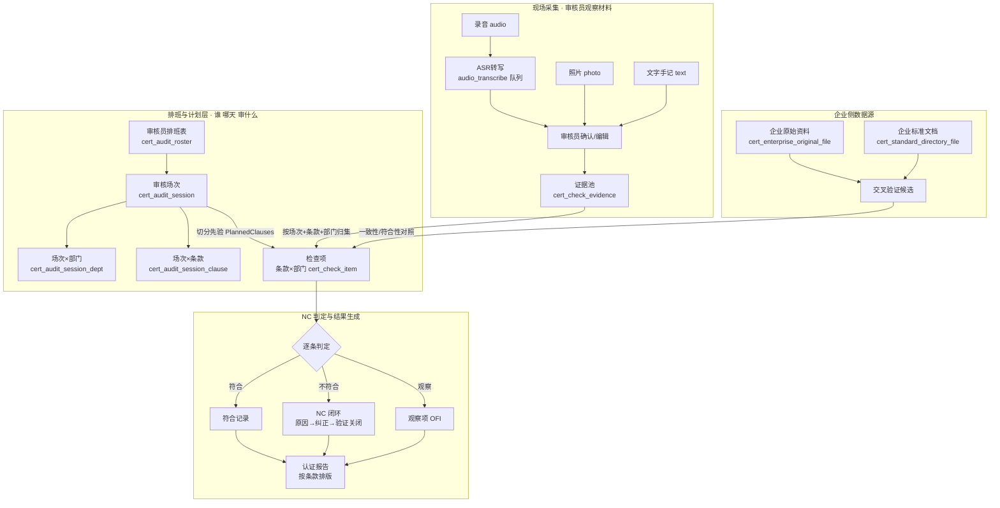
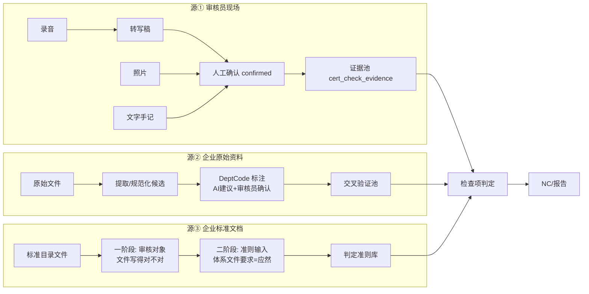
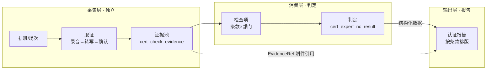

---
AIGC:
    Label: "1"
    ContentProducer: 001191440300708461136T1XGW3
    ProduceID: 9a16bac6e27d25132787d930f50d9879_22435d74cb8e11f196f9525400248c00
    ReservedCode1: 9CuY+bJbW9cN1Q57+Xe1jS5OlA5ytUOyAxQ74w46zwd+QBqWwoSWSUBXwWDljoC2XgweZo56S22JLjDNzcjsh5QNEnSOSu65DC8ssPhbM0B+HglV609ucs1ufwHwWm7Pm/PHRvOXe6TB3ItM76hYh00fOa4fQIrFrdAZ7404Y0kTnw/RPzXVvcDfaL8=
    ContentPropagator: 001191440300708461136T1XGW3
    PropagateID: 9a16bac6e27d25132787d930f50d9879_22435d74cb8e11f196f9525400248c00
    ReservedCode2: 9CuY+bJbW9cN1Q57+Xe1jS5OlA5ytUOyAxQ74w46zwd+QBqWwoSWSUBXwWDljoC2XgweZo56S22JLjDNzcjsh5QNEnSOSu65DC8ssPhbM0B+HglV609ucs1ufwHwWm7Pm/PHRvOXe6TB3ItM76hYh00fOa4fQIrFrdAZ7404Y0kTnw/RPzXVvcDfaL8=
---

# 37 · 审核员排班与三源数据流设计（V1）

> 目标：理清**审核员观察材料（现场证据）**、**企业原始资料**、**企业标准文档（认证资料）** 三者在 NC 流程中的数据流向、排版与结果生成，并新增**审核员排班表**及**针对排班上传结果的表**。
>
> 依据：36 号文档（现场证据通道与规范化时序）已定结论直接复用——场次是第一轮过滤键、检查项 = 条款 × 部门、证据池 CarrierType 统一、报告按条款不按部门。
>
> 范围：本版**只做数据流与表设计**，不涉及端侧实现（手机 App / 电脑端同步 / 手动上传交互）——端侧只影响"证据写入证据池的通道"，不影响表结构与数据流方向，故先解耦，后续单独设计。

---

## 一、总体数据流（一张图看懂）



**一句话链路**：排班（谁哪天去）→ 场次（开几场会、审哪些条款哪些部门）→ 采集（录音/照片/文字，经转写与确认进证据池）→ 归集（证据挂到条款×部门检查项）→ 判定（对照标准+体系文件准则）→ NC 闭环 → 报告按条款排版输出。

---

## 二、三源在 NC 流程中的角色与介入点

| 数据源 | 表 | 性质 | 介入环节 | 角色 |
|---|---|---|---|---|
| ① 审核员观察材料（现场证据） | `cert_check_evidence`（新建） | 实然的另一半（实际做了什么） | 判定主输入 | **判定依据**：录音转写+确认 / 照片+人工观察结论 / 文字手记 |
| ② 企业原始资料 | `cert_enterprise_original_file`（已有） | 实然的一半（未整理的真实记录） | 交叉验证 | **候选证据**：一致性比对（①vs② 印证、②vs③ 对照），不进主判定链 |
| ③ 企业标准文档（认证资料） | `cert_standard_directory_file`（已有） | 应然（规定应该怎么做） | 一阶段=审核对象；二阶段=准则输入 | **判定准则**：体系文件要求 + 标准条款 |

### 2.1 三源流向详图



---

## 三、新增：审核员排班表（`cert_audit_roster`）

> 排班 = **谁、哪天、去审哪家企业、哪个阶段**。排班是"计划层"的根，场次挂在排班之下（一天可开多场）。

```sql
CREATE TABLE cert_audit_roster (
    Code            VARCHAR(64) PRIMARY KEY,      -- GUID
    EnterpriseCode  VARCHAR(64) NOT NULL,          -- 受审企业
    StageCode       VARCHAR(64) NOT NULL,          -- 阶段（初次二阶段/监督/再认证）
    AuditorCode     VARCHAR(64) NOT NULL,          -- 审核员账号
    RosterDate      DATE NOT NULL,                 -- 排班日期
    Location        VARCHAR(255),                  -- 审核地点（企业地址/会议室）
    Status          VARCHAR(20) DEFAULT 'planned', -- planned/confirmed/done/cancelled
    Remark          VARCHAR(500),
    CreatedAt       DATETIME,
    CreatedBy       VARCHAR(64)
);
```

**规则**：
- 一个排班 = 一名审核员在某企业某阶段某天的一次出勤；
- 一天可多条排班（不同审核员 / 不同企业）；
- 一个排班下可挂多个**场次**（上午车间走查、下午管理层访谈）；
- 排班创建方：机构后台排程或审核员自报（端侧实现暂缓，表结构不依赖创建端）。

---

## 四、场次与关联表（36 号结论落地，挂到排班下）

```sql
-- 4.1 审核场次：一次会议/一个受审单元
CREATE TABLE cert_audit_session (
    Code              VARCHAR(64) PRIMARY KEY,
    RosterCode        VARCHAR(64) NOT NULL,        -- ★ 所属排班 FK
    EnterpriseCode    VARCHAR(64) NOT NULL,
    StageCode         VARCHAR(64) NOT NULL,
    SessionName       VARCHAR(255),                -- 「安全部访谈」「车间现场走查」
    ProcessAreaName   VARCHAR(255),                -- ★ 原文保留「过程/区域」（GM/MR、采购过程…）
    PlannedDate       DATE,
    ActualStartTime   DATETIME,                    -- 录音起点对齐
    ActualEndTime     DATETIME,
    Location          VARCHAR(255),
    PlannedClausesJson TEXT,                       -- ★ 切分先验：本场覆盖条款快照
    NoticeSentTime    DATETIME,                    -- 计划告知企业时间（合规留痕）
    NoticeConfirmedBy VARCHAR(64),                 -- 企业确认人
    RecordConsent     TINYINT DEFAULT 0,           -- 是否同意录音
    Status            VARCHAR(20) DEFAULT 'planned' -- planned/in_progress/done/cancelled
);

-- 4.2 场次×部门（M:N）
CREATE TABLE cert_audit_session_dept (
    Code            VARCHAR(64) PRIMARY KEY,
    SessionCode     VARCHAR(64) NOT NULL,
    DeptCode        VARCHAR(64) NOT NULL,
    Sort            INT DEFAULT 0,
    LeadPersonName  VARCHAR(64),                   -- 该部门接待人（样本「行政人资部：杨青」）
    IsPrimary       TINYINT DEFAULT 0              -- 是否主场
);

-- 4.3 场次×条款（M:N，切分先验）
CREATE TABLE cert_audit_session_clause (
    Code           VARCHAR(64) PRIMARY KEY,
    SessionCode    VARCHAR(64) NOT NULL,
    ClauseCode     VARCHAR(64) NOT NULL,
    StandardCode   VARCHAR(8),                     -- Q/E/H
    Sort           INT DEFAULT 0
);
```

---

## 五、针对排班上传结果的表（证据池 + 判定结果）

> 核心思想：**排班/场次 → 证据 → 判定结果 全程用 Code 贯穿**。任何一条证据都能回答"哪场会、哪个部门、哪个条款、什么载体"；任何一条判定结果都能追溯"基于哪些证据、出自哪场会"。

### 5.1 现场证据池 `cert_check_evidence`（源①落库）

```sql
CREATE TABLE cert_check_evidence (
    Code              VARCHAR(64) PRIMARY KEY,
    SessionCode       VARCHAR(64) NOT NULL,        -- ★ 哪场会的证据（贯穿排班）
    CheckItemCode     VARCHAR(64),                 -- 归集到哪个检查项（可空=待归集）
    DeptCode          VARCHAR(64),                 -- 归属部门（空=全公司级，如管理评审）
    ClauseCode        VARCHAR(64),                 -- 归属条款
    CarrierType       VARCHAR(10) NOT NULL,        -- text/photo/audio/file
    SourceFileCode    VARCHAR(64),                 -- 原始文件（录音/照片/上传文件）
    LocationType      VARCHAR(10),                 -- page/span/timestamp
    LocationValue     VARCHAR(255),                -- 页/字符区间/[00:12:35-00:14:20]
    ContentText       TEXT,                        -- 文字手记/转写稿/人工观察结论
    TranscriptCode    VARCHAR(64),                 -- 转写稿引用（audio 专用）
    Status            VARCHAR(20) DEFAULT 'draft', -- draft/confirmed/archived
    CreatedBy         VARCHAR(64),
    CreatedAt         DATETIME
);

-- 5.2 转写稿（audio 专用，ASR 输出 → 人工确认 → confirmed）
CREATE TABLE cert_audio_transcript (
    Code              VARCHAR(64) PRIMARY KEY,
    EvidenceCode      VARCHAR(64),                 -- 回指证据池
    SourceFileCode    VARCHAR(64),                 -- 原始音频
    ContentMd         TEXT,                        -- 带时间戳+说话人分离的 Markdown
    SpeakerCount      INT,
    DurationSec       INT,
    Status            VARCHAR(20) DEFAULT 'draft', -- draft/confirmed/rejected
    ConfirmedBy       VARCHAR(64),                 -- ★ 审核员本人确认
    ConfirmedAt       DATETIME
);
```

### 5.3 检查项（条款 × 部门，判定单元）

```sql
CREATE TABLE cert_check_item (
    Code               VARCHAR(64) PRIMARY KEY,
    TaskCode           VARCHAR(64) NOT NULL,       -- 所属审核任务
    ClauseCodeRaw      VARCHAR(128),               -- ★ 原文（Q 5.2.1/2 E & H 5.2，只显示）
    ClauseCode         VARCHAR(64),                -- 结构化条款（只查询）
    StandardCodesJson  TEXT,                       -- ["Q","E","H"]
    Status             VARCHAR(20) DEFAULT 'pending' -- pending/evidencing/judged
);

-- 检查项×部门（多选）
CREATE TABLE cert_check_item_dept (
    Code           VARCHAR(64) PRIMARY KEY,
    CheckItemCode  VARCHAR(64) NOT NULL,
    DeptCode       VARCHAR(64) NOT NULL
);
```

### 5.4 判定结果表 `cert_expert_nc_result`（结果生成）

```sql
CREATE TABLE cert_expert_nc_result (
    Code               VARCHAR(64) PRIMARY KEY,
    CheckItemCode      VARCHAR(64) NOT NULL,       -- 判定哪个检查项
    SessionCode        VARCHAR(64),                -- ★ 贯穿：出自哪场会
    Result             VARCHAR(10) NOT NULL,       -- conform / nc / ofi
    EvidenceRef        TEXT,                       -- ★ 证据引用（evidenceCode 列表，判定依据）
    ContentText        TEXT,                       -- 判定说明/不符合陈述
    DeptCode           VARCHAR(64),                -- 从检查项继承，可修正（根因可能在别部门）
    Severity           VARCHAR(10),                -- major/minor（Result=nc 时）
    Status             VARCHAR(20) DEFAULT 'draft',-- draft/confirmed/closed
    -- NC 闭环字段
    RootCause          TEXT,
    CorrectiveAction   TEXT,
    VerifyResult       TEXT,
    VerifiedAt         DATETIME
);
```

---

## 六、NC 流程中的排版与结果生成规则

### 6.1 排版总原则（36 号结论）

| 对象 | 排版/组织方式 | 依据 |
|---|---|---|
| 检查项 | **条款 × 部门**（同条款不同部门 = 不同检查项） | 样本 E6.1.2 出现 4 次 |
| 证据 | **按场次归集**，再按条款+部门挂检查项 | 场次是第一轮过滤键 |
| NC | 从检查项生成，**继承部门**，可人工修正 | 企业整改要知道找谁 |
| 报告 | **按条款组织章节**（ReportSection.ClauseCode），部门信息写在正文 | ISO 17021-1，报告不像报告会废 |

### 6.2 结果生成顺序（数据流时序）

```
① 排班建成（谁哪天去）                    cert_audit_roster
     ↓
② 场次声明（几场会/部门/条款/是否录音）    cert_audit_session(+dept/clause)
     ↓
③ 现场采集（录音/照片/文字 → 转写→确认）  cert_check_evidence(+transcript)
     ↓
④ 证据归集（按场次+部门+条款挂检查项）     cert_check_evidence.CheckItemCode
     ↓
⑤ 逐条判定（证据 vs 准则：标准+体系文件） cert_expert_nc_result
     ↓
⑥ NC 闭环（原因→纠正→验证关闭）          cert_expert_nc_result 闭环字段
     ↓
⑦ 报告排版（按条款章节，NC 挂部门进正文）  report_section + nc_result
```

### 6.3 三源在判定中的权重

| 载体 | 置信度 | 判定角色 |
|---|---|---|
| 文字手记（审核员亲手记） | 高 | 直接判定 |
| 录音转写 + 审核员确认 | 中高 | 直接判定（确认后） |
| 照片 + 人工观察结论 | 中 | 辅助判定（AI 描述不可作依据） |
| 企业原始资料 | 中（候选） | 交叉验证（①vs② 印证 / ②vs③ 一致性） |
| 企业标准文档 | — | 判定准则（应然），一阶段是审核对象 |

### 6.4 数据流向关键约束

1. **未确认的证据不能进判定**（转写稿 draft 状态不参与）；
2. **未归集的证据不算数**（`CheckItemCode` 为空 = 还没挂到检查项）；
3. **部门过滤必须三条并集**：`本场部门 ∪ 空部门（全公司级）∪ 显式跨部门引用`，否则管理层证据（方针/管理评审/目标）永远查不到；
4. **NC 必须可追溯**：`EvidenceRef` 指向具体证据 Code，判定理由里呈现"哪场会+哪个部门+哪段证据"；
5. **报告不挂部门**：部门信息进 NC 与章节正文，不进报告结构。

---

## 七、端侧实现方案（Flutter App 为主通道）

> 更新：端侧不再"暂缓"，方案已明确——**Flutter App 为现场取证主通道**。表结构依然不依赖端侧实现方式，证据写入 `cert_check_evidence` 的三条候选通道状态更新如下：

| 候选通道 | 说明 | 状态 |
|---|---|---|
| A. 电脑直读手机 | 电脑端直接拉取手机端录音/照片（局域网/云同步） | 走 App 能力实现（Flutter 本地存储 + 局域网/云同步拉取） |
| B. 手机手动上传 | 审核员在手机端勾选文件手动上传 | 走 App 能力实现（App 内选择本地文件上传至证据池） |
| C. 电脑端上传 | 审核员回办公室后从电脑上传（最朴素兜底） | 保留为兜底通道 |

**结论**：表结构（排班→场次→证据→检查项→判定→报告）先行落地，端侧以 Flutter App 为主通道实施，A/B 由 App 能力覆盖，C 保留兜底。无论走 A/B/C，最终都写入同一张 `cert_check_evidence`，数据流不变。

---

## 八、模块边界确认（独立开发可行性）

> 结论先行：**体系认证报告、企业资料规范化均不受排班/录音转文字影响**，可独立开发、独立测试、独立交付。

### 8.1 报告 = 只引用不依赖

报告生成**只吃检查项判定结果（`cert_expert_nc_result`）的结构化数据**：

- 报告输入：`cert_expert_nc_result` 的 Result / ContentText / Severity / DeptCode 等结构化字段 + 检查项条款信息；
- 录音、照片**仅作为证据引用（`EvidenceRef`）呈现附件**，不参与报告结构生成、不参与章节排版；
- 因此报告模块可脱离排班、转写、取证通道独立开发测试——只要给它一份判定结果数据即可出报告。

### 8.2 企业资料规范化 = 无耦合

企业资料规范化发生在**认证申请前 / 一阶段文件审核**环节：

- 输入：企业上传资料 + 规范化模板（提取、标注 DeptCode 等）；
- 输出：交叉验证候选池（`cert_enterprise_original_file` 规范化结果）；
- 与**二阶段现场取证无数据依赖**——现场取证不消费、不等待规范化结果，规范化也不依赖排班/转写。

### 8.3 三层职责与上下游关系



**模块边界结论**：

| 模块 | 是否受排班/转写影响 | 说明 |
|---|---|---|
| 认证报告 | 否（只引用） | 只依赖 `cert_expert_nc_result` 结构化数据；录音/照片仅作 EvidenceRef 附件 |
| 企业资料规范化 | 否（无耦合） | 发生在申请前/一阶段，输入=资料+模板，与二阶段取证无数据依赖 |
| 证据链/取证 | —（独立采集层） | 排班与转写是证据链**输入端** |
| NC 检查 | —（消费层） | 证据池的**消费端**，与取证无功能重叠，是同一数据流上下游 |

---

## 九、外部系统接入与不自研边界

### 9.1 通用能力不自研原则

| 能力 | 决策 | 理由 |
|---|---|---|
| 语音转文字（ASR） | **不自研** | 讯飞听见 / 通义听悟均提供开放 API 与私有化部署，准确率与成本远优于自研 |
| 排班 | 轻量自研 或 承接外部结果 | 排班逻辑简单可自研；机构已有排班时直接接入/导入，不重复建设 |

### 9.2 数据孤岛而非重复开发

审核员困惑的根因是**数据孤岛**，不是缺少重复开发：

- 机构已有排班表 / 转写稿时，平台应支持 **"导入 / 接入"** 而非要求重新录入；
- **排班结果**：支持 Excel 导入 / 日历同步，对齐数通国软 ALMS、认证王等机构 ERP 的导出格式；
- **转写稿**：支持原音频直传 + 调用云端转写 API，平台只做队列调度与确认闭环。

### 9.3 外部数据获取三路径（按成本低到高）

| 路径 | 方式 | 对接成本 | 适用场景 |
|---|---|---|---|
| ① 文件导入兜底 | Excel/Word 模板导入（排班表、转写稿均可） | 零对接 | 无接口、一次性、任何机构可用 |
| ② 开放 API 对接 | 转写 API 优先；机构 ERP 开放 API 较少，需逐家谈判 | 中 | 有 API 且可谈的机构（转写云服务优先） |
| ③ 人工同步通道 | 手机采集 → 电脑拉取（走 Flutter App + 电脑端） | 低 | 外部系统完全不配合时兜底 |

---

## 十、手机端取证方案选型（Flutter App vs 小程序）

> 结论：**现场取证以 Flutter App 为主**；小程序/公众号**不作取证通道**，仅可作通知/查看类轻入口。

### 10.1 关键对比表

| 维度 | 小程序 | Flutter App | 结论 |
|---|---|---|---|
| 长录音（1-2 小时访谈） | 小程序后台/锁屏录音易中断，iOS 受限，不可靠 | 原生后台录音稳定 | **App 胜** |
| 离线能力（车间网络差） | 弱，依赖微信环境与网络 | 本地 SQLite + 文件存储，无网可采 | **App 胜** |
| 相机/相册 | 受微信调用限制 | 原生能力完整 | **App 胜** |
| 大文件本地累积 | 受限 | 本地文件管理自由 | **App 胜** |
| 数据链路 | 经微信中转，链路长 | 直连后端 API | **App 胜** |
| 分发 | 免安装，但需企业主体认证 | 需开发者账号/TestFlight/企业签名/APK 直装 | 各有取舍 |
| 开发成本 | 需额外学习小程序框架 | 用户熟悉 Flutter，一套代码双端 | **App 胜** |

### 10.2 落地顺序

```
① 后端 + 管理端先行
   证据池表（cert_check_evidence / cert_audio_transcript）、外部排班导入、转写 API 接入
   —— 不受 App 进度影响，可先行开发
     ↓
② Flutter App 取证端
   录音 → 转写 → 上传；拍照 → 上传；文字手记
   打通 cert_check_evidence 落库
     ↓
③ 电脑端拉取/查看证据 + 判定工作流
   A/B 通道走 App 能力，C 通道兜底；审核员在电脑端完成判定
     ↓
④ 小程序（可选）
   通知/查看类轻入口，不作取证通道
```

---

## 十一、待确认点

1. 排班表创建方：机构后台排程 / 审核员自报 / 两者兼有？（影响 `CreatedBy` 与状态机）
2. 一天多场次的默认规则：按"上午/下午"拆分还是按"过程区域"拆分？
3. 录音转写走本地模型（whisper 私有化）还是云端 API？（影响 `audio_transcribe` 执行器配置，不影响表结构）
4. 手机端 App 是否支持 iOS 企业签名分发？（影响分发策略与上线路径）

---

*本文档为数据流设计 V1，待确认后进入实施。*
*（内容由AI生成，仅供参考）*
