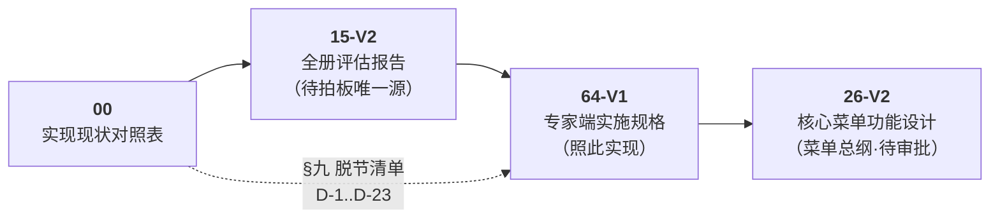

# 40-实施 · 企业资料规范化（中转站）

> **状态**：🟡 **在制品（中转站）** ｜ **迁入**：2026-10-05（原 `20-体系认证/03-详细设计/05-`）
> **中转机制**：本册为**正在开发/完善的模块文档中转站**，开发完成后按功能域定稿迁回 `20-体系认证/03-详细设计/`。
> **★ 2026-10-13 深度清理**：顶层 **68 → 24 份**（-64%）；**44 份 md + 5 个原型已归档**至
> [`90-归档/旧版本/归档-2026-10-13-企业资料规范化清理/`](../../90-归档/旧版本/归档-2026-10-13-企业资料规范化清理/)（含逐份理由 + 替代关系）。

---

## ★ 一句话定位

> **企业散乱原始资料 → 画像 → 模板锚点 → 填写规则 → 规范化执行引擎 → 标准目录下的标准文档。**

跨「后台端(定义侧) + 专家端(执行侧)」两平台且含 Shared 共享层，**不是单个模块**。

---

## 一、★ 权威链与阅读顺序（编码前按此顺序读）

| 顺序 | 文档 | 读它解决什么 |
|------|------|--------------|
| **①** | [`00-实现现状对照表-V1.md`](./00-实现现状对照表-V1.md) | **现状第一入口**：§三 端点/表实测 · §八 代码残留 G/R 清单 · §九 文档-代码脱节 D-1…D-23 |
| **②** | [`15-全册评估报告-V2.md`](./15-全册评估报告-V2.md) | **待拍板唯一源**：§0.3 `Q-01`…`Q-25` 状态 · §0.4 `G-01`…`G-11` · §0.5 `Q-A…Q-D`（三合一，含 `17`/`18` 附录） |
| **③** | [`64-专家端企业资料规范化实施规格-V1.md`](./64-专家端企业资料规范化实施规格-V1.md) | **照此实现的唯一规格**：六章 2,037 行（现状能力 / 数据模型两口径 / 页面交互 / 执行链路 / 端点 WBS 进度账） |
| **④** | [`26-核心菜单功能设计（待审批）-V2.md`](./26-核心菜单功能设计（待审批）-V2.md) | **菜单总纲**：`AGENTS.md` 业务菜单速览的权威源 |
| **⑤** | [`68-定位决策书与收尾计划-V1.md`](./68-定位决策书与收尾计划-V1.md) | ★ **范围与优先级**：做什么/不做什么 · P0–P4 排期 · 三验证指标 · 止损线（**排期前必读**） |

> ⛔ **不要再从 `01`~`12` 读起** —— 初期编号册已归档，与实现严重脱节。
> ⛔ **不要再读 `参考/41-00~04`** —— 已全文并入 `64`（其中 `41-00`「3 个致命缺口、执行层 0%」**已被实现推翻**）。

---

## 二、体系边界（为何拆成这套册）

| 侧 | 平台 | 代码落点 | 职责 |
|----|------|---------|------|
| **定义侧** | 后台端 `cert-admin` | `DocTemplateAnchor`、`SourceResolver`、`FillParamDef/Value`、`AiFillInvoker` | 模板上传/锚点扫描、填写规则、全局参数、技能/Prompt |
| **执行侧** | 专家端 `cert-auditor` | `DocumentFillOrchestrator`（7 步）、`DocFillValue/Action/Log`、`WordFillWriter/ExcelFillWriter` | 编排、取值、AI 提炼、单元格/整表写入 |
| **共享层** | `CertPlatform.Shared` | 实体 `DocFillLog/DocAiSuggestion`、`SourceResolver`、Office 写入器 | 两端共用基础 |

> ⚠️ **双端交叉处理**：能力归属不按平台硬切，Shared 单列；交叉通过 README 双向引用表达，不重复放文档。
> 详见 [`跨端共享与核心资源检索规则-V1.md`](../../30-项目规则/跨端共享与核心资源检索规则-V1.md)。

---

## 三、顶层文档状态速查（27 份 · 2026-10-20 起）

> **`status` 语义**（`文档生命周期管理规范-V1.md` §4.4）：`living` = 必须与代码同步，过时即 BUG；`archived` = 允许过时，读时自行核对实现。
> 状态图标：✅ 已实现 ｜ 📝 设计有效待实现 ｜ ⏳ 待审批

### 现役权威（6 份 `living`）

| # | 文档 | 行 | status | 一句话 |
|---|------|----|--------|--------|
| `00` | [实现现状对照表-V1](./00-实现现状对照表-V1.md) | 265 | `living` ✅ | **现状第一入口**，滚动维护 |
| `15` | [全册评估报告-V2](./15-全册评估报告-V2.md) | 1,280 | `living` 📝 | **待拍板唯一源**，三合一 |
| `26` | [核心菜单功能设计（待审批）-V2](./26-核心菜单功能设计（待审批）-V2.md) | — | `living` ⏳ | 菜单级总纲 |
| `64` | [专家端企业资料规范化实施规格-V1](./64-专家端企业资料规范化实施规格-V1.md) | 2,037 | `living` 📝 | **照此实现的唯一规格** |
| `68` | [定位决策书与收尾计划-V1](./68-定位决策书与收尾计划-V1.md) | 172 | `living` ✅ | **范围与优先级权威**：做什么/不做什么/P0–P4/止损线 |
| — | `README.md`（本文件） | — | `living` | 权威链 + 速查 + 待审批清单 |

### ⏳ 待审批设计（2 份 `review` —— 2026-10-14 新建，用户批准前 ⛔ 不写码）

| # | 文档 | status | 一句话 |
|---|------|--------|--------|
| `65` | [填写来源与参数归属分析及修复计划-V2](./65-填写来源与参数归属分析及修复计划-V2.md) | `review` ⏳ | **用户四问分析 + 8 缺口 + 4 条裁决**（D-1 撤销 / D-2 关闭 / D-3 采纳 / D-4 转 `66`） |
| `66` | [参数通用服务与统一填写组件设计-V2](./66-参数通用服务与统一填写组件设计-V2.md) | `review` ⏳ | **D-4 专册**：通用 Service `IFillParamService`（查询 + 补录收口）+ 通用组件 `FillParamForm` + 入队前补参弹窗 |

### 设计文档（19 份 `archived` —— 允许过时，读时核对实现）

| # | 文档 | status | 一句话 |
|---|------|--------|--------|
| `11` | [既有资料承接索引-V1](./11-既有资料承接索引-V1.md) | `archived` 📝 | 老资料承接清单 |
| `13` | [企业资料管理设计方案-V3](./13-企业资料管理设计方案-V3.md) | `archived` 📝 | **表结构与页面设计权威**（与统一表架构强耦合，`06-企业资料管理` 引用） |
| `16` | [模板标注与Skill流程化方案-V2](./16-模板标注与Skill流程化方案-V2.md) | `archived` 📝 | 标注规范 `W1–W9`/`E1–E8`，架构骨架已定 |
| `19` | [模板生成规则落位与标签规范-V1](./19-模板生成规则落位与标签规范-V1.md) | `archived` 📝 | 「分类/字段留原页、生成规则独立菜单」裁决 |
| `20` | [空白模板存储方案与页面原型-V1](./20-空白模板存储方案与页面原型-V1.md) | `archived` 📝 | 模板存储与 `FieldCode` 冻结 |
| `22` | [填写单元属性分类与取值来源模型-V1](./22-填写单元属性分类与取值来源模型-V1.md) | `archived` 📝 | 7×4×5 分类 + `SourceSpec`；一期收窄已实测 |
| `23` | [全局填写规则与参数维护设计-V1](./23-全局填写规则与参数维护设计-V1.md) | `archived` 📝 | 层 2 文档级规则 |
| `25` | [纸面实验实测报告-V1](./25-纸面实验实测报告-V1.md) | `archived` ✅ | 167 份实测：确定性锚点 **98.6%**，一期只用 3~4 组合 |
| `33` | [文档语义规则设计-V1](./33-文档语义规则设计-V1.md) | `archived` 📝 | 后台 MENU 语义规则详设（V1.6，含 §五 DDL） |
| `34` | [核心模块定位与端到端流程-V1](./34-核心模块定位与端到端流程-V1.md) | `archived` ✅ | **已核准**，行动顺序 0→9 |
| `36` | [企业原始资料管理设计-V1](./36-企业原始资料管理设计-V1.md) | `archived` ✅ | 上游菜单⑤**已审批已实施**（`MENU_AUD_11`） |
| `37` | [标准文档填写规则设计-V1](./37-标准文档填写规则设计-V1.md) | `archived` ✅ | 后台 MENU_00218 写侧规则 |
| `38` | [文档填写Skill开发计划-V1](./38-文档填写Skill开发计划-V1.md) | `archived` 📝 | `S-1` 已完成 / `S1`+`S2` **未开工**（V1.8 已证伪旧口径） |
| `39` | [文档填写Skill详细设计-V1](./39-文档填写Skill详细设计-V1.md) | `archived` 📝 | **8 个 Skill 的签名/参数/步骤**；与 `38` 冲突时**以 `39` 为准** |
| `41` | [文档填写规则页交互重构方案（待审批）-V3](./41-文档填写规则页交互重构方案（待审批）-V3.md) | `archived` ⏳ | 后台 doc-fill-rule 页交互，R5 五改，**待审批** |
| `49` | [标准文档标准化页面设计-V4](./49-标准文档标准化页面设计-V4.md) | `archived` 📝 | 标准化页设计 V4 |
| `61` | [填写规则完整分析与实施计划-V1](./61-填写规则完整分析与实施计划-V1.md) | `archived` ✅ | **含用户最终裁定 `R-1~R-3` / `S-1~S-4`**（2026-10-09，逐字） |
| `63` | [文档填写规则与锚点填写实现评审意见-V1](./63-文档填写规则与锚点填写实现评审意见-V1.md) | `archived` 📝 | 实现评审意见 |
| `99` | [架构哲学-ZYH-STD-ENT统一表设计-V1](./99-架构哲学-ZYH-STD-ENT统一表设计-V1.md) | `archived` ✅ | **D11 统一表裁决**（模板行/企业行共表共域），两线共同底座 |

### 目录与原型

| 路径 | 内容 |
|------|------|
| `原型/` | **现役**：`41-…-原型-V7.html`（21 断言）· `62-…-原型-V4.html` + `check-v62d.mjs`（**136 断言全过**）· `README-V7.md` |

---

## 四、⏳ 待审批 / 待拍板清单

| 类 | 项 | 载体 | 状态 |
|----|----|------|------|
| **待审批** | 核心菜单功能设计（26 号 V2） | `26` | ⏳ 用户审批 |
| **待审批** | 文档填写规则页交互重构（41 号 V3 + 原型 V7） | `41-V3` | ⏳ 用户审批 |
| **待审批** | 填写来源与参数归属（65 号 V2：4 条裁决已答复） | `65-V2` | ⏳ 用户审批（仅剩修复计划排期） |
| **待审批** | 参数通用服务与统一填写组件（66 号 V2：4 条已裁决） | `66-V2` | ⏳ 用户审批（进入实施） |
| **待拍板** | `Q-01`…`Q-25`（**14 项已由实现闭环 / 12 项仍开放**） | `15-V2` §0.3 | ⏳ 逐条裁决 |
| **待拍板** | `G-01`…`G-11`（3 闭环 / 5 部分 / 3 开放） | `15-V2` §0.4 | ⏳ |
| **待拍板** | `Q-A…Q-D`（A/B/C 实践已答，**D 待正式登记**） | `15-V2` §0.5 | ⏳ |
| **待裁决** | `16` §13 待决议题关闭前 **⛔ 不得编码** | `16` §13 | ⏳ |

---

## 五、归档批次

| 批次 | 日期 | 规模 | 说明 |
|------|------|------|------|
| [`归档-2026-10-05-企业资料规范化演进稿/`](../../90-归档/旧版本/归档-2026-10-05-企业资料规范化演进稿/) | 2026-10-05 | 重号与旧版 / 过程性草稿 / 历史原型 | 源目录 `05-` 注销时的首轮清理 |
| [`归档-2026-10-13-企业资料规范化清理/`](../../90-归档/旧版本/归档-2026-10-13-企业资料规范化清理/) | 2026-10-13 | **44 md + 5 原型**（7 个子目录，逐份理由） | 本次深度清理；权威链重写为 `00 → 15-V2 → 64-V1 → 26` |

> ⛔ **编号不复用**：两批归档释放的编号**禁止再新建同号文档**；新文档续号 **67+**（`65` / `66` 已于 2026-10-14 使用）。

---

## 六、配套同步（2026-10-13 已核）

| 项 | 状态 |
|----|------|
| `20-体系认证/03-详细设计/README.md` | ✅ `05-` 条目指向本中转站 |
| `06-企业资料管理/README.md` + `01`/`02` | ✅ `05-企业资料规范化/` 旧前缀已改 `40-实施/企业资料规范化/` |
| `30-项目规则/跨端共享与核心资源检索规则-V1.md` | ✅ `26` 号引用路径已修正 |
| `40-实施/README.md` 目录表 | ✅ 更新为「24 份 + 归档 44」 |
| `40-实施/分析报告/` 两份 | ✅ 活口径指针修正 + 顶部加路径更名说明 |
| `docs/00-工程体系/文档生命周期管理规范-V1.md` §4.4 | ✅ 5 份 `living` 已登记 |
| 断链检测 | ✅ `check_broken_links_20261013.py` → **0**（活跃层 517 条链接） |
| 正式回迁 | ⬜ 开发完成后按功能域（定义/执行/共享）定稿迁回 |

## 七、待办（数据库文档专项）

- [ ] **数据库文档同步**：`02-数据库设计` 长期未更新。需从 `DB/mysql/*.sql` + `scripts/db/*` 实表反推，核对本体系全部表结构（`cert_doc_template`、`cert_enterprise_*`、`cert_fill_param_*`、`cert_doc_fill_*` 等）与代码实体一致后，回写正式 DB 设计文档。
      ⚠️ 独立任务，待本体系开发完成、表结构稳定后执行。
